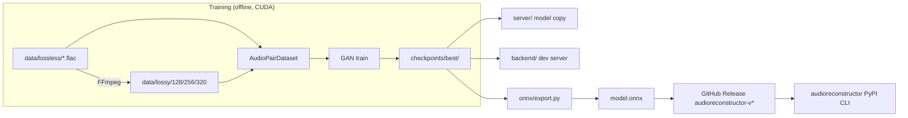
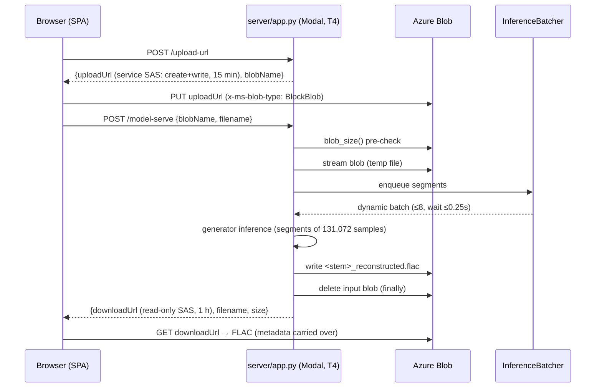

# Monorepo Architecture — `audioreconstruction`

> A complete map of this repository's package hierarchy, dependency topology, and data flows. If you only read one file, read this one.

**Last verified:** October 2026 · **Version (root):** `1.2.1`

---

## Table of Contents

1. [What This Repo Is](#1-what-this-repo-is)
2. [The Big Picture](#2-the-big-picture)
3. [Package Hierarchy](#3-package-hierarchy)
4. [Dependency Topology](#4-dependency-topology)
5. [Core Package: `model/`](#5-core-package-model)
6. [Delivery Path A: `backend/` (Local Dev Server)](#6-delivery-path-a-backend-local-dev-server)
7. [Delivery Path B: `server/` (Production Modal.com)](#7-delivery-path-b-server-production-modalcom)
8. [Delivery Path C: `onnx/` (PyPI Package & Binary CLI)](#8-delivery-path-c-onnx-pypi-package--binary-cli)
9. [Frontend: `frontend/`](#9-frontend-frontend)
10. [Evaluation: `test/`](#10-evaluation-test)
11. [Supporting Directories](#11-supporting-directories)
12. [Data Flow Diagrams](#12-data-flow-diagrams)
13. [Environment & Configuration Map](#13-environment--configuration-map)
14. [Command Reference](#14-command-reference)
15. [Key Constraints & Gotchas](#15-key-constraints--gotchas)

---

## 1. What This Repo Is

**GAN-based audio super-resolution**: reconstructs lossless-quality FLAC audio from lossy MP3 source (128 / 256 / 320 kbps).

- A 1D **U-Net generator** (~28M params) paired with a **multi-scale discriminator** (~25M params), trained with mixed precision on CUDA.
- Architecture insight: the generator uses a **residual connection** — `output = generator(input) + input` — so it learns to predict the *difference* between lossy and lossless audio, not the full waveform.
- Three independent delivery paths: a local dev server, a production GPU server on Modal.com, and a torch-free ONNX CLI shipped to PyPI.
- A React SPA frontend that uploads MP3s and lets users download reconstructed FLACs.

For product intent and target user, see [`PRODUCT.md`](PRODUCT.md). For the design system (color tokens, typography), see [`DESIGN.md`](DESIGN.md).

---

## 2. The Big Picture

This is a **multi-package monorepo**: one Python/training core at the root, plus four sub-projects that each own their environment and lockfile. The root `pyproject.toml` is the *training + server* environment. The sub-projects under `onnx/` and `frontend/` deliberately do **not** inherit it.

```
audioreconstruction/
│
├── model/            ← Training core (root env, Python 3.12, uv)
├── backend/          ← Local dev FastAPI server (root env)
├── server/           ← Production FastAPI server on Modal.com (root env)
├── onnx/             ← Torch-free ONNX inference subtree (own uv.lock)
│   └── cli/          ← "audioreconstructor" PyPI package (own pyproject.toml + uv.lock)
├── frontend/         ← React 19 + Vite 8 + Tailwind 4 (own package.json, bun)
├── test/             ← Standalone audio-similarity eval CLIs (root env)
│
├── data/             ← Audio dataset (git-ignored, user-provided + generated)
├── media/            ← Screenshots, recordings, samples for README
├── docs/             ← Governance docs + agent guidance
├── openspec/         ← OpenSpec change proposals (planning artifacts)
├── docker/           ← (empty — reserved)
├── plugin/           ← (empty — reserved)
├── design/           ← Design brief
└── .github/          ← CI workflows, PR/issue templates, agent hooks
```

### The five "walls"

Understanding this repo means understanding **which walls are real**:

| # | Wall | Why it exists |
|---|------|--------------|
| 1 | `model/` ↔ `server/model/` | The production container is built via `modal add_local_dir` over `server/` only. It gets a **self-contained copy** of the inference-only model code — no torch-training deps cross the wall. |
| 2 | root ↔ `onnx/` | The ONNX path runs **without PyTorch** (onnxruntime only) so it can ship as a small pip package and PyInstaller binary. It is fully self-contained. |
| 3 | `onnx/` ↔ `onnx/cli/` | The CLI package ships the *downloader/orchestrator*, not the model. It bundles no weights, no ONNX runtime — it fetches the native exe + `model.onnx` from a GitHub Release at runtime via `setup`. |
| 4 | Python ↔ `frontend/` | The frontend talks to servers only over HTTP, and uploads audio **directly to Azure Blob Storage** via pre-signed SAS URLs — it never proxies through the GPU container. |
| 5 | `test/` ↔ everything | Evaluation scripts are standalone CLIs run ad-hoc (`python -m test.<script>`), not a pytest suite wired into other packages. |

---

## 3. Package Hierarchy

Full inventory, dir by dir. **Core** entries are code you own and edit; **artifact** entries are generated and should not be hand-edited.

### Root

| Entry | Type | Purpose |
|---|---|---|
| `pyproject.toml` | Core | Root project `audioreconstruction` v1.2.1 (training + servers). Manages `model/`, `backend/`, `server/`, `test/`, `onnx/` (export only). |
| `uv.lock` | Artifact | Root lockfile (uv-managed). |
| `requirements.txt` | Artifact | Legacy pip freeze (`~236 KB`) — kept for reference; prefer uv. |
| `.python-version` | Core | Pins **Python 3.12** for root uv env. |
| `CLAUDE.md` / `AGENTS.md` | Core | Repo guidance for AI agents. `AGENTS.md` is a **symlink** to `CLAUDE.md` — keep in sync automatically. |
| `README.md`, `MONOREPO.md`, `PRODUCT.md`, `DESIGN.md` | Core | User-facing readmes, this document, product intent, design system. |
| `LICENSE` (MIT), `LICENSE-GPL` | Core | Dual licensing. |
| `.pre-commit-config.yaml`, `.gitignore`, `.gitattributes` | Core | Tooling config. |
| `skills-lock.json` | Artifact | Agent skill lockfile. |

### `model/` — Training core

| File | Role |
|---|---|
| `config.py` | Three dataclasses — `ModelConfig` (architecture), `TrainConfig` (hyperparameters), `DataConfig` (paths). `ModelConfig` serializes to/from JSON for checkpoint portability. |
| `prepare_data.py` | FFmpeg batch transcoder: FLAC → MP3 at 128/256/320 kbps. Pairing is by stem name. |
| `dataset.py` | `AudioPairDataset` (lossy, lossless pairs; random bitrate per item). `build_splits()` → 80/20 train/val. |
| `train.py` | Full GAN loop: mixed precision (`torch.amp`), gradient checkpointing, Rich progress. Saves best ckpt by validation spectral loss. |
| `evaluate.py` | Inference/eval. `load_generator()` is the shared loader used by `backend/`. Segments audio in 131,072-sample (~3s) chunks. PESQ + SNR when reference FLACs exist. |
| `export.py` | Strips discriminator → saves generator only (`model.safetensors` + `config.json`) for HuggingFace. |
| `generator.py` | 1D U-Net generator (~28M params), residual output. |
| `discriminator.py` | Multi-scale discriminator (~25M params). |
| `losses.py` | LSGAN adversarial (w=1.0), multi-scale STFT spectral (w=100.0), feature matching (w=10.0). |
| `utils.py` | Shared helpers incl. `copy_metadata` (ID3 → Vorbis tag carry-over). |
| `conversion_to_pt.py`, `coversion_to_safetensors.py` | One-off weight-format converters. *(Note: "coversion" typo lives in the filename.)* |
| `checkpoints/` | **Artifact** — trained weights. `best/` + `config.json`. Format: `generator.safetensors`, `discriminator.safetensors`, `training_state.pt` (epoch + optimizer states), `config.json`. |

All modules run as `python -m model.<name>`.

### `backend/` — Local dev server

| File | Role |
|---|---|
| `main.py` | Single-file FastAPI app. Routes: `GET /`, `GET /health-check`, `POST /model-serve` (multipart upload). |
| `__init__.py` | Package marker. |
| `.env.example` | Template for `CHECKPOINT_DIR` env var. |

⚠️ **See gotcha in §15** — this server's upload contract is now *legacy* and the current frontend does **not** work against it.

### `server/` — Production server (Modal.com)

| File | Role |
|---|---|
| `app.py` | Production FastAPI app. Four routes incl. pre-signed upload flow (§7). `slowapi` rate limits, strict CORS → `https://audioreconstruction.vercel.app`. |
| `modal_app.py` | Modal `App` + container image definition. T4 GPU, `min_containers=0`, `max_containers=2`, `scaledown_window=60`. Wraps `app.py` via `@modal.asgi_app()`. |
| `batcher.py` | `InferenceBatcher` — dynamically batches concurrent segment requests (≤ `MAX_BATCH_SIZE=8`, `MAX_WAIT_S=0.25`) on a single-thread executor so GPU inference isn't serialized. |
| `audio_io.py` | soundfile load/write + ID3→Vorbis metadata copy. |
| `blob_storage.py` | Azure Blob Storage mints (SAS) + moves blobs. Zero FastAPI imports; raises `BlobStorageError` which `app.py` translates to HTTP. |
| `model/` | **Vendored inference-only copy**: `config.py`, `evaluate.py`, `generator.py` (+ `checkpoints/`). No training/dataset/loss modules. |
| `requirements.txt` | Pinned deps for the Modal image build. |

### `onnx/` — Torch-free delivery (`onnx/` subtree is self-contained)

| File | Role |
|---|---|
| `export.py` | PyTorch generator → `onnx/exported/model.onnx` + `config.json`. Entry: `python -m onnx.export`. |
| `inference.py` | Torch-free inference (onnxruntime + soundfile + scipy + mutagen). Runs as a **subprocess** with a line-oriented stdout contract: `PROGRESS <0-100>`, `DONE <path>` (exit 0), `ERROR <CODE> <msg>` (exit ≠ 0). One process per file. |
| `audioreconstructor.spec` | PyInstaller spec → standalone native binary (per-OS) into `dist/`. |
| `manifest.json` | Asset manifest (SHA-256 + byte size per asset) used for release verification. |
| `config.json` | Model architecture config shipped alongside the ONNX graph. |
| `requirements.txt` | Subtree deps (onnxruntime, soundfile, scipy, mutagen). |
| `test_metadata.py` | Metadata-copy verification script. |
| `exported/` | **Artifact** — generated ONNX graph + config. |
| `dist/` | **Artifact** — PyInstaller binary output. |
| `README.md` | Subtree readme. |

### `onnx/cli/` — The `audioreconstructor` PyPI package

| Entry | Role |
|---|---|
| `pyproject.toml`, `uv.lock` | **Own environment.** Supports Python 3.10–3.13 (root is 3.12). |
| `src/audioreconstructor/` | Package source: |
| ├ `__main__.py`, `__init__.py` | `python -m audioreconstructor` entry. |
| ├ `app.py` | Click group — three commands: `setup`, `doctor`, `enhance` (`--input/--output` single file, `--folder` recursive batch). |
| ├ `cli.py` | Asset bootstrapper: downloads native exe + `model.onnx` + `config.json` from the GitHub Release tagged `audioreconstructor-v<version>` (derived from the *installed* package version). Verifies SHA-256 against `manifest.json`. Retries + backoff. Caches per-version. Then spawns the native binary and parses the PROGRESS/DONE/ERROR contract. |
| ├ `batch.py` | Folder discovery + output mapping. Mirrors the input tree under `<folder>/enhanced/`; skips output dir + hidden files. |
| └ `ui.py` | Spotify-styled Rich TUI (banners, progress, result/summary panels). |
| `tests/` | unittest-based pytest suite. |
| `tools/generate_manifest.py` | Produces `manifest.json` for a release. |
| `dist/`, `openspec/`, `CHANGELOG.md`, `README.md` | Build output, subtree changes, docs. |

### `frontend/` — Web app

| Entry | Role |
|---|---|
| `package.json` (+ `bun.lock` — note: a stale `pnpm-lock.yaml` also exists) | **Own env** — bun-managed. |
| `vite.config.js` | Vite config; dev proxies `/api/*` to the backend. |
| `src/App.jsx` | Single-file app component. Uploads MP3 → Azure Blob (SAS PUT) → polls `/model-serve` → links the reconstructed FLAC. |
| `src/main.jsx`, `src/index.css` | Entry + Tailwind 4 styles. |
| `index.html`, `public/` | Shell + static assets. |
| `eslint.config.js` | Lint config. |
| `CLAUDE.md` / `AGENTS.md` | Detailed frontend state model + retry/backoff docs. |
| `dist/`, `node_modules/` | **Artifact** — build + deps. |

### `test/` — Audio similarity evaluation

Standalone CLIs, **not** pytest (root pytest currently has no test files to collect).

| File | Role |
|---|---|
| `eval_flac.py` | Compare `original.flac` ↔ `reconstructed.flac`. |
| `eval_mp3.py` | Compare `reference.flac` ↔ `compressed.mp3` (baseline quality). |
| `snr.py`, `pesq.py`, `lsd.py`, `mel_ssim.py`, `si_sdr.py` | Metric modules consumed by the eval scripts. |
| `README.md` | Script docs. |

Run: `uv run python -m test.<script>`.

### Supporting dirs

| Dir | Contents |
|---|---|
| `docs/` | `CODE_OF_CONDUCT.md`, `CONTRIBUTING.md`, `SECURITY.md`, `agents/` (agent guidance: `domain.md`, `issue-tracker.md`, `triage-labels.md`). |
| `openspec/` | `config.yaml` + `changes/` — OpenSpec proposals: `add-concurrency-dynamic-batching`, `add-frontend-input-limits`. Read these for context on partially-implemented features. |
| `.github/` | `workflows/`: `ci.yml` (PR checks), `build-matrix-deploy.yml` (multi-OS build/deploy), `publish-pypi.yml` (PyPI publish). `ISSUE_TEMPLATE/`, `pull_request_template.md`, `prompts/`, `skills/`, `hooks/`. |
| `media/` | `samples/` (`input.mp3`, `output.flac` — demo pair), `recordings/`, `screenshots/`. |
| `design/` | `design-brief.md`. |
| `docker/`, `plugin/` | Empty — reserved. |

---

## 4. Dependency Topology

```
                        ┌─────────────── ROOT ENV (uv, py3.12) ───────────────┐
                        │                                                      │
 data/lossless/*.flac ──► model/prepare_data ──► data/lossy/{128,256,320}/    │
                        │         │                                            │
                        │         ▼                                            │
                        │      model/dataset ──► model/train ──► checkpoints/  │
                        │         │                   │                        │
                        │         ▼                   ▼                        │
                        │   model/losses+discriminator   model/evaluate ──┐    │
                        │                                                  │    │
                        │   backend/main.py  ◄─────────────────────────────┤    │  dev-only
                        │                                                  │    │
                        │   server/ (app.py + modal_app.py + batcher.py)   │    │  prod
                        │      └── server/model/  ◄── vendored eval copy   │    │
                        │                                                  │    │
                        │   onnx/export.py ──► onnx/exported/model.onnx    │    │  export only
                        └──────────────────────────────────────────────────┴────┘

 ┌─ onnx/ (torch-free env) ────────────────────────────────────────────┐
 │  onnx/inference.py ◄── onnx/exported/model.onnx                     │
 │  PyInstaller (audioreconstructor.spec) ──► dist/audioreconstructor  │
 │  tools/generate_manifest.py ──► manifest.json                       │
 └─────────────────────────────────────────────────────────────────────┘
                │ uploaded to GitHub Release audioreconstructor-v<ver>
                ▼
 ┌─ onnx/cli/ (pip env, py3.10–3.13) ─────────────────────────────────┐
 │  audioreconstructor CLI → setup (fetch assets, verify SHA-256)     │
 │  → doctor → enhance ──► spawns native binary subprocess            │
 └─────────────────────────────────────────────────────────────────────┘

 ┌─ frontend/ (bun env) ───────────────────────────────────────────────┐
 │  React SPA → PUT to Azure Blob (SAS) → poll server /model-serve     │
 └─────────────────────────────────────────────────────────────────────┘
```

### Import relationships (who depends on whom)

| From | On | Contract |
|---|---|---|
| `backend/main.py` | `model/evaluate.load_generator`, `model.generator`, `model.utils` | Direct import — they live in one env. |
| `server/` | `server/model/*` (vendored) | **Nothing** on the GPU container imports root `model/`. That's why `server/model/` exists. |
| `onnx/inference.py` | `onnx/exported/model.onnx` | Reads the exported graph + config; zero torch. |
| `onnx/cli` | native binary + `model.onnx` + `config.json` from GitHub Releases | Version-locked: package version ↔ release tag. |
| `frontend/` | prod server HTTP API + Azure Blob SAS | Pre-signed PUT of the raw MP3; no `/api` upload proxy in prod. |

### Version lockstep (critical)

```
onnx/cli/pyproject.toml version  ⇄  GitHub Release tag "audioreconstructor-v<version>"
```

`setup` derives the release tag from the installed package version. Bumping one without the other breaks asset fetching. Also note: root `dev` deps pin `audioreconstructor>=1.2.0`, so the published CLI is developed partly against itself.

---

## 5. Core Package: `model/`

### Pipeline stages

```
prepare_data ──► dataset ──► train ──► evaluate ──► export
 (FFmpeg)      (pairs)     (GAN)      (inference)  (HF weights)
```

1. **`prepare_data`** — requires FFmpeg. For each `data/lossless/*.flac`, write `data/lossy/{128,256,320}/<stem>.mp3`.
2. **`dataset`** — pairs by stem; each item randomly samples a bitrate (teaches robustness across quality tiers).
3. **`train`** — 200 epochs default / batch 4 / lr 1e-4. Checkpoint dir per epoch, best by validation spectral loss. `--resume` support.
4. **`evaluate`** — runs the generator in 131,072-sample segments (~3s @44.1 kHz), concatenates, writes FLAC, copies source metadata.
5. **`export`** — HuggingFace-ready generator-only weights.

### Loss stack (see `losses.py`)

| Loss | Weight | Description |
|---|---:|---|
| LSGAN adversarial | 1.0 | Discriminator minimax. |
| Multi-scale spectral | 100.0 | STFT at 512/1024/2048 — L1 on magnitude + log-magnitude. |
| Feature matching | 10.0 | L1 on discriminator intermediate activations. |

The 100:10:1 weighting means spectral fidelity dominates — the GAN term acts as a sharpener, not the objective itself.

---

## 6. Delivery Path A: `backend/` (Local Dev Server)

`uv run uvicorn backend.main:app --reload`

- Routes: `GET /`, `GET /health-check`, `POST /model-serve` (multipart upload → streams FLAC back).
- Loads checkpoint from `CHECKPOINT_DIR` (default `model/checkpoints/best/`).
- Permissive CORS (`*`), sequential single-request processing, no batching, no rate limits.
- Imports root `model/` directly — fastest iteration loop during training research.

---

## 7. Delivery Path B: `server/` (Production Modal.com)

Deploy: `cd server && modal deploy modal_app.py`

Four routes on `app.py`:

| Route | Method | Limit | Purpose |
|---|---|---|---|
| `/` | GET | 10/min | Landing/info. |
| `/health-check` | GET | 10/min | Liveness. |
| `/upload-url` | POST | 20/min | Mint service SAS. |
| `/model-serve` | POST | 40/min | Kick off reconstruction on a blob; mint download SAS. |

### Pre-signed upload flow (audio never touches the GPU container)

```
1. POST /upload-url ───────► { uploadUrl, blobName }
                              blobName = uuid4().hex + ".mp3"
                              service SAS: one blob, create+write, 15 min

2. Browser PUT uploadUrl ──► Azure Blob directly
                              requires header "x-ms-blob-type: BlockBlob"
                              ALSO requires the storage account to have a CORS
                              rule allowing PUT/GET from the frontend origin

3. POST /model-serve { blobName, filename }
                              blobName re-validated against _BLOB_NAME_RE
                              (used as a temp-file path — unvalidated would be
                              traversal bug)
                              blob_size() pre-check before GPU work
                              ──► { downloadUrl, filename, size }
                              read-only SAS, 1 hour, content_disposition set to
                              save as "<stem>_reconstructed.flac"
```

- Input blob deleted in `finally`. Output blobs cleaned by an Azure lifecycle rule.
- Dynamic batching (`batcher.py`): ≤ 8 concurrent segments, 0.25 s max wait, single-thread executor.

### Configuration

Env vars come from the Modal secret `azure-blob`:

`AZURE_STORAGE_ACCOUNT`, `AZURE_STORAGE_KEY`, `AZURE_UPLOAD_CONTAINER`, `AZURE_OUTPUT_CONTAINER`, optional `AZURE_BLOB_ENDPOINT` (Azurite for local testing).

---

## 8. Delivery Path C: `onnx/` (PyPI Package & Binary CLI)

**Why it exists:** serve users who can't/won't run a GPU server — the model runs on-CPU, torch-free, in a native binary. The subtree is independent of the root project: `onnx/cli/` ships `pyproject.toml` + `uv.lock`.

### Release pipeline

```
1. Train (root env) ──► export.py ──► onnx/exported/model.onnx + config.json
2. inference.py                  torch-free ONNX runtime (subprocess contract)
3. PyInstaller (audioreconstructor.spec) ──► dist/audioreconstructor  (per-OS)
4. tools/generate_manifest.py ──► manifest.json  (SHA-256 + size per asset)
5. Upload exe + model.onnx + config.json + manifest.json
        to GitHub Release tagged "audioreconstructor-v<version>"
6. Bump onnx/cli/pyproject.toml version to match.
        ← package version and release tag MUST stay in lockstep
7. publish-pypi.yml workflow publishes onnx/cli to PyPI.
```

### CLI surface (`audioreconstructor`)

| Command | What it does |
|---|---|
| `setup` | Download native exe + model + config for the *installed* version; SHA-256 verify against `manifest.json`; cache per-version. |
| `doctor` | Sanity-check the installation (runtime, cached assets, platform). |
| `enhance --input X --output Y` | Reconstruct one file (Rich progress driven by `PROGRESS` lines from the subprocess). |
| `enhance --folder DIR` | Recursive batch; output mirrored under `DIR/enhanced/`. |

Anything else — native binary spawn, retries + backoff on transient download errors, PROGRESS/DONE/ERROR parsing — lives in `cli.py`.

---

## 9. Frontend: `frontend/`

Stack: React 19 + Vite 8 + Tailwind CSS 4, bun-managed, single-file app (`src/App.jsx`).

```bash
cd frontend && bun install && bun dev     # dev server (/api/* proxies to backend)
cd frontend && bun lint
cd frontend && bun run build              # → dist/
```

State model highlights (full detail in `frontend/CLAUDE.md`):

- Narrow right-to-left flow: choose MP3 → mint SAS → direct upload (with retry/backoff) → poll `/model-serve` → download link (FLAC stems `_reconstructed`).
- Targets the **production server's contract** (SAS flow). Expect 25 MB / 6 min input guardrails.
- Production deploy target: `https://audioreconstruction.vercel.app` (also the server's strict-CORS allowlist).

---

## 10. Evaluation: `test/`

Standalone CLIs — deliberately **not** part of the pytest suite:

```bash
uv run python -m test.eval_flac "original.flac" "reconstructed.flac"
uv run python -m test.eval_mp3  "reference.flac" "compressed.mp3"
```

`eval_mp3` establishes the lossy baseline; `eval_flac` scores the GAN output against the lossless reference. Metrics live in per-metric modules: `snr.py`, `pesq.py`, `lsd.py`, `mel_ssim.py`, `si_sdr.py`.

---

## 11. Supporting Directories

| Dir | Notes |
|---|---|
| `data/` | `lossless/` (source FLAC, user-provided) → `lossy/{128,256,320}/` (generated MP3). Not committed. |
| `media/` | README assets: `samples/` (`input.mp3` + `output.flac` demo pair), `recordings/`, `screenshots/`. |
| `docs/` | Governance: `CONTRIBUTING.md`, `SECURITY.md`, `CODE_OF_CONDUCT.md`; `agents/` — how AI agents route issues (Linear + GitHub) and triage labels. |
| `openspec/` | Planned/in-flight changes as proposals; explains why a half-built feature looks the way it does. |
| `.github/` | —— `ci.yml` — PR checks (uv, ruff, pytest skeleton); `build-matrix-deploy.yml`; `publish-pypi.yml` (PyPI publish for `onnx/cli`). Templates, agent prompts/skills/hooks. |
| `design/`, `docker/`, `plugin/` | Brief only / reserved-empty / reserved-empty. |

---

## 12. Data Flow Diagrams

### End-to-end (product view)



### Request lifecycle (production)



---

## 13. Environment & Configuration Map

| Env | Manager | Python | Where config lives |
|---|---|---|---|
| root (`model/`, `backend/`, `server/`, `test/`) | uv | 3.12 pinned | `pyproject.toml` + `uv.lock` |
| `onnx/` (export/inference orchestration) | uv | — | `requirements.txt` |
| `onnx/cli/` | uv | 3.10–3.13 | `pyproject.toml` + `uv.lock` |
| `frontend/` | bun | Node | `package.json` + `bun.lock` |

### Environment variables

| Var | Used by | Meaning |
|---|---|---|
| `CHECKPOINT_DIR` | `backend/main.py` | Checkpoint path (default `model/checkpoints/best/`) — see `backend/.env.example`. |
| `AZURE_STORAGE_ACCOUNT` / `AZURE_STORAGE_KEY` | `server/blob_storage.py` | Azure credentials (Modal secret `azure-blob`). |
| `AZURE_UPLOAD_CONTAINER` / `AZURE_OUTPUT_CONTAINER` | `server/` | Blob container names. |
| `AZURE_BLOB_ENDPOINT` | `server/` | Point at Azurite for local testing. |

### Config objects

`model/config.py` — `ModelConfig`, `TrainConfig`, `DataConfig` dataclasses; `ModelConfig` round-trips through JSON (carried in every checkpoint as `config.json`, letting inference rebuild the exact architecture).

---

## 14. Command Reference

All commands assume repo root unless `cd` shown.

### Setup

```bash
uv sync                        # root Python deps
cd onnx/cli && uv sync         # CLI package deps
cd frontend && bun install     # frontend deps
pre-commit install             # git hooks (.pre-commit-config.yaml)
```

### Train

```bash
uv run python -m model.prepare_data                          # FLAC → MP3x3
uv run python -m model.train                                 # 200 ep / batch 4 / lr 1e-4
uv run python -m model.train --resume model/checkpoints/epoch_50
```

### Infer / eval

```bash
uv run python -m model.evaluate --checkpoint model/checkpoints/best --input song.mp3 --output output/
uv run python -m model.evaluate --checkpoint model/checkpoints/best --input data/lossy/128/ --output output/ --reference data/lossless/
uv run python -m model.export --checkpoint model/checkpoints/best          # HF weights
uv run python -m test.eval_flac "original.flac" "reconstructed.flac"
uv run python -m test.eval_mp3  "reference.flac" "compressed.mp3"
```

### Servers

```bash
uv run uvicorn backend.main:app --reload      # dev
cd server && modal deploy modal_app.py        # prod (needs modal auth)
```

### Frontend

```bash
cd frontend && bun dev && bun lint && bun run build
```

### ONNX & CLI

```bash
uv run python -m onnx.export                                   # torch → model.onnx
uv run python onnx/inference.py --input song.mp3 --output song.flac   # torch-free
cd onnx && pyinstaller audioreconstructor.spec                 # native exe → dist/
cd onnx && uv run python cli/tools/generate_manifest.py --version 1.1.0
cd onnx/cli && uv run pytest                                   # CLI tests
cd onnx/cli && uv run ruff check .
```

### Quality

```bash
uv run ruff check .       # root lint
uv run pytest             # root tests (currently collects nothing)
```

---

## 15. Key Constraints & Gotchas

### Hard constraints

- Python 3.12 pinned at root (`.python-version`); root requires ≥3.10; `onnx/cli` supports 3.10–3.13.
- **CUDA required for training** (mixed precision assumes CUDA). Inference falls back to CPU, slowly.
- FFmpeg must be installed for `prepare_data`.
- Audio invariant: **stereo, 44.1 kHz** (`in_channels=2`).
- Weights are **safetensors only** (never `.pt`) — except legacy `training_state.pt` inside checkpoints.
- Upload limit both servers: **25 MB / 6 minutes**.

### Gotchas (learn the hard way, here instead)

1. **`backend/` is legacy-contract and frontend-incompatible.** Its docstring says it plainly: still multipart upload; the prod server moved to the SAS flow. The current frontend does **NOT** work against `backend/`. Point Vite's proxy at the prod server, or port `backend/` to the SAS contract. *Still: when changing inference behavior for prod, edit `server/` — `backend/` is dev-only.*
2. **Edit `server/model/`, not `model/`, for production behavior.** The container packages `server/` alone; root-edits never reach Modal.
3. **Azure storage account needs a CORS rule** allowing PUT/GET from the frontend origin — otherwise the browser's direct SAS upload fails silently in step 2 of the pre-signed flow.
4. **Package version ⇄ release tag lockstep** for `audioreconstructor` (see §8). Mismatch breaks `setup`.
5. **`AGENTS.md` is a symlink to `CLAUDE.md`** — edit once, both update. Do not create a divergent copy.
6. **Don't run `model/` as a script** — always `python -m model.<module>` (relative imports depend on it).
7. `docker/` and `plugin/` are empty placeholders. `requirements.txt` at root is a stale freeze artifact — uv + `pyproject.toml` is the source of truth.
8. The `device` field in `ModelConfig` defaults to `"cuda"`; check/set device explicitly when inferring on CPU.

---

*This document is generated-by-hand against the repo state as of Oct 2026. If you change package boundaries, lockfiles, or route contracts, update this file in the same PR.*
